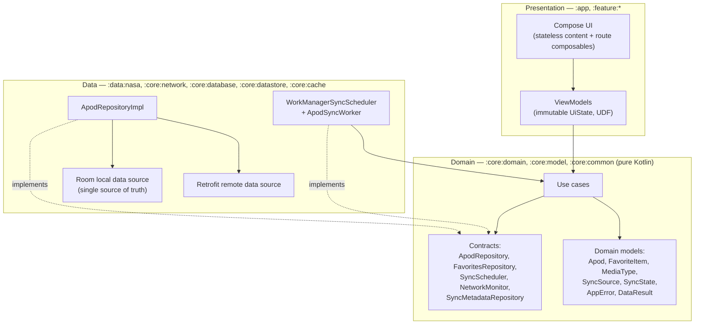
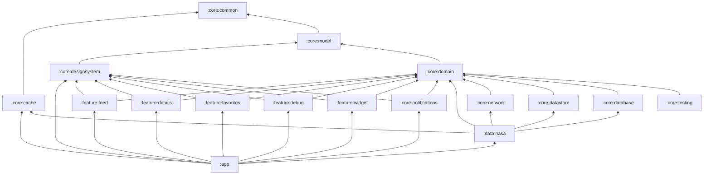
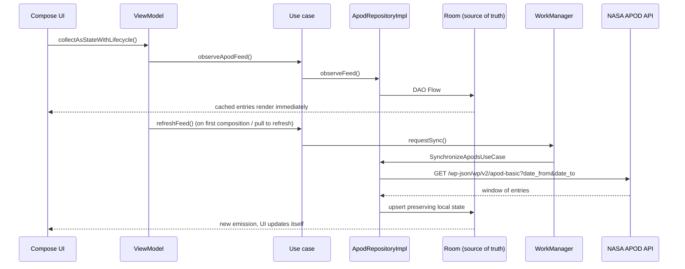
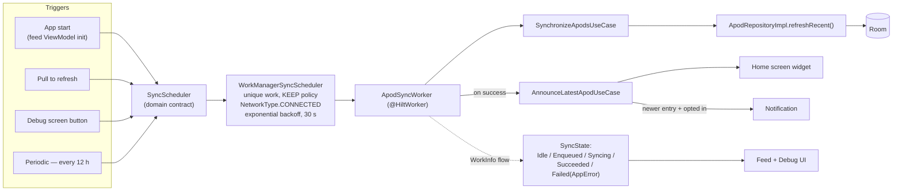
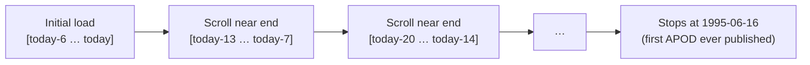
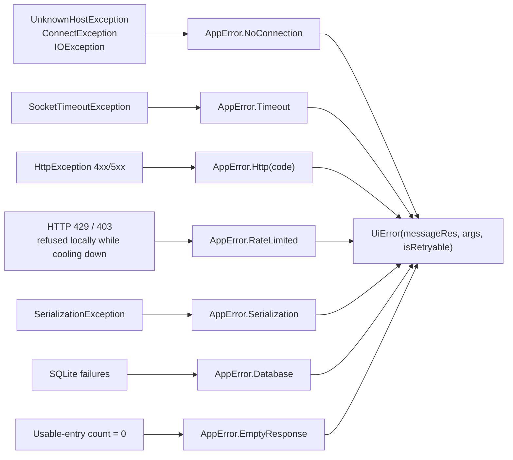

# NASA Explorer

An offline-first Android application built around NASA's **Astronomy Picture of the Day (APOD)** API.

The point of this project is not the feature set — it is the engineering: Clean Architecture across a
real multi-module Gradle build, a database that is the single source of truth, background
synchronisation through WorkManager, date-range pagination over an API that has no pages, and a test
suite that runs the whole stack on a JVM with no emulator.

| | |
|---|---|
| **Language** | Kotlin 2.4.20 |
| **UI** | Jetpack Compose, Material 3 |
| **Min / Target / Compile SDK** | 26 / 37 / 37 |
| **Build** | AGP 9.4.0 (built-in Kotlin), Gradle 9.7.1, convention plugins |
| **Modules** | 16 Gradle modules + an included `build-logic` build |
| **Tests** | 192 unit/Robolectric/Compose tests, no device required |

---

## Table of contents

1. [Screens](#screens)
2. [Architecture](#architecture)
3. [Module graph](#module-graph)
4. [Extension points for new data sources](#extension-points-for-new-data-sources)
5. [Offline-first strategy](#offline-first-strategy)
6. [Room strategy](#room-strategy)
7. [Synchronisation strategy](#synchronisation-strategy)
8. [Pagination: date ranges instead of pages](#pagination-date-ranges-instead-of-pages)
9. [Error handling](#error-handling)
10. [Connectivity](#connectivity)
11. [Dependency injection](#dependency-injection)
12. [Testing strategy](#testing-strategy)
13. [Setup](#setup)
14. [Engineering highlights](#engineering-highlights)
15. [Architectural decisions and trade-offs](#architectural-decisions-and-trade-offs)
16. [Known limitations](#known-limitations)

---

## Screens

The bottom bar has five tabs: **Today · Universe · Earth · Favourites · More**. Today is the APOD feed
(with room for other features' cards above it); Universe and Earth list what each tab offers and say
"coming soon" until the roadmap's features land; More holds Debug (and, later, settings).

| Screen | What it does |
|---|---|
| **Today (feed)** | Chronological APOD feed with thumbnail, title, date, media-type badge and favourite state. Pull to refresh, infinite scroll backwards through the archive, offline banner, empty/offline/error states. |
| **Details** | Full-size image (HD when available) or video still with a "watch video" action, title, date, explanation, copyright, favourite toggle. |
| **Universe gallery** | The Universe tab's home: curated rails of Webb and Hubble images (galaxies, nebulae, black holes, the Milky Way) cached for offline use, full-text search over NASA's image, video and audio library with media-type and year filters, and a details screen with zoom, in-app playback, download of the original and saving to Favourites. Other Universe features are listed above the rails. |
| **Favorites** | Saved items of every source (APOD today; library images, rover and Earth photos as they land), drawn from a snapshot taken when saved. Works with the network fully disabled. |
| **Home screen widget** | The latest picture with its title and date, re-rendered after every sync; tapping it opens that entry's details. |
| **New-entry notification** | Opt-in from the bell on the feed's top bar. After a sync brings in a newer entry, posts its title and picture; tapping opens the details screen. |
| **Debug** (More tab) | Live view of the offline-first machinery: connectivity, cached entry count, favourites count, oldest cached date, oldest requested window, last successful sync, WorkManager sync state, every data source's last success / last error / next allowed refresh, plus buttons to trigger a sync and re-register the periodic one. |

---

## Architecture

Clean Architecture, three layers, dependencies pointing inwards. The domain layer is a **pure Kotlin
JVM module** — it cannot depend on Android, Retrofit or Room, because those types are not even on its
compile classpath.



Rules the codebase actually enforces:

* The UI never touches Retrofit, Room, DataStore, WorkManager or `ConnectivityManager`.
* DTOs stop at the data layer; Room entities stop at the data layer. Only `Apod` crosses upwards.
* Exceptions stop at the data layer; only `AppError` crosses upwards.
* Synchronisation lives in a worker driven by a use case — never in a Composable, never inside a
  ViewModel.

---

## Module graph



| Module | Type | Responsibility |
|---|---|---|
| `:app` | Android app | Entry point, navigation host with one nested graph per tab, bottom bar, tab hubs, the Today-card and favourite-routing registries, DI wiring of app-level choices (dispatchers, clock, HTTP config), WorkManager configuration. |
| `:core:common` | **Pure Kotlin** | `AppError`, `DataResult`, dispatcher qualifiers, `TimeProvider`. No project dependencies at all. |
| `:core:model` | **Pure Kotlin** | `Apod`, `MediaType`, `SyncState`, `FavoriteItem`/`FavoriteSource`, `SyncSource`. |
| `:core:domain` | **Pure Kotlin** | Use cases and repository/scheduler/monitor contracts. |
| `:core:network` | Android library | OkHttp, JSON, `RetrofitFactory`, per-host rate limiting (`RateLimitInterceptor`), exception→`AppError` mapping, `ConnectivityManager`-backed `NetworkMonitor`. API-agnostic. |
| `:core:database` | Android library | Room database, `ApodEntity`/`ApodDao`, the cross-source `favorite` table and its `FavoritesRepository` implementation, migrations, exported schemas. |
| `:core:cache` | Android library | `CacheEvictor` contract and the daily `CacheEvictionWorker` that runs every registered evictor. |
| `:core:datastore` | Android library | Preferences DataStore implementation of the per-source sync bookkeeping and of the user's preferences. |
| `:core:designsystem` | Android library | Material 3 theme, typography, shared components (`ApodCard`, `NasaAsyncImage`, state views), `AppError`→`UiError` presentation mapping, bitmap loading and the details deep-link intent for out-of-app surfaces. |
| `:core:map` | Android library | `SpaceMap` composable over MapLibre Native: NASA GIBS raster tiles (layer, date, matrix set) on a Blue Marble base, plus an overlay API (markers, lines, polygons, tap callbacks) that exposes no MapLibre types. |
| `:core:notifications` | Android library | `NewApodNotifier` implementation: notification channel, big-picture notification, deep link into details. |
| `:core:testing` | **Pure Kotlin** | Fakes for every domain contract, test data builders, `MainDispatcherRule`, `FixtureServer` (recorded JSON through MockWebServer). Shared by all test source sets. |
| `:data:nasa` | Android library | NASA DTOs and endpoints, remote/local data sources, mappers, `ApodRepositoryImpl`, sync worker and scheduler, API key handling. |
| `:data:nasaimages` | Android library | NASA Image and Video Library: Retrofit service, DTOs, mappers to `NasaMedia`, its own small Room database (rails and saved items), in-memory search page cache, `NasaMediaCacheEvictor`. |
| `:feature:*` | Android libraries | One screen each: Compose UI, ViewModel, UI state, and its own type-safe navigation contract. |
| `:feature:universe` | Android library | Universe gallery (rails and search) and the NASA library details screen. |
| `:feature:widget` | Android library | Glance home screen widget for the latest entry and the `LatestApodWidgetUpdater` implementation. |
| `build-logic` | Included build | Convention plugins (`nasaexplorer.android.application/library/compose/feature/hilt/room`, `nasaexplorer.jvm.library`). |

Feature modules do not depend on each other, and never on `:data:nasa` — they only see `:core:domain`
and `:core:designsystem`. `:app` is the only module that knows the full graph.

Each feature owns its navigation route (`@Serializable data object FeedRoute`,
`DetailsRoute(date)`, …) and exposes `NavGraphBuilder` extensions, so adding a screen does not mean
editing a central route enum.

---

## Extension points for new data sources

The roadmap adds a dozen APIs. The shared plumbing they need exists once, so each new source is a
data module, a feature module and a few lines of wiring.

**Navigation (`:app`).** `TopLevelDestination` fixes the five tabs; each tab is a nested graph
(`TodayGraph`, `UniverseGraph`, `EarthGraph`, `FavoritesGraph`, `MoreGraph`). A feature registers its
`NavGraphBuilder` extension inside the graph of its tab in `NasaNavHost`, which keeps that tab
selected and the bar visible. Universe, Earth and More start on a hub screen whose entries are listed
in `UniverseHub.kt`, `EarthHub.kt` and `MoreHub.kt` — one `HubEntry` per feature. A feature that
should *be* a tab's first screen replaces the hub as that graph's `startDestination`.

**Today cards (`:app`).** `TodayCards.kt` is the list of composables shown above the APOD feed (the
feed's `header` slot). A feature exposes a card composable and adds one line there.

**Favourites (`:core:model`, `:core:domain`).** `FavoriteSource` already lists APOD, EPIC,
NASA_LIBRARY, MARS and EXOPLANET (persisted keys — never rename). Features save with
`SaveFavoriteUseCase(source, itemId, title, imageUrl)`, remove with `RemoveFavoriteUseCase`, and drive
a heart with `ObserveIsFavoriteUseCase`. The Favourites tab lists every source from the snapshot;
tapping one is routed by `NavHostController.openFavorite` in `FavoriteNavigation.kt`, where a feature
maps its source to its screen.

**Rate limits (`:core:network`).** `RateLimitInterceptor` sits on the shared OkHttp client, so every
Retrofit service and Coil go through it. A 429, or `X-RateLimit-Remaining: 0`, puts the host into a
cooldown until `Retry-After` (or the host's budget window, or one minute); calls during a cooldown
fail locally with `AppError.RateLimited` without touching the network. Hosts with a known quota have
a sliding-window `HostRateBudget`: Launch Library 2 (15/hour) and api.nasa.gov (1,000/hour) are
pre-registered; another module adds `@Provides @IntoSet HostRateBudget(host, maxRequests, window)`.

**Sync bookkeeping (`:core:domain`).** `SyncSource` lists every roadmap API. Wrap a refresh in
`RefreshSourceUseCase(source, minInterval) { repository.refresh() }`: it skips the call while the
source is not due (its interval, or a rate-limit cooldown), and records last success, last error and
next allowed refresh, which the Debug screen lists per source.

**Cache eviction (`:core:cache`).** Contribute `@Binds @IntoSet CacheEvictor` per table you cache;
the daily `CacheEvictionWorker` runs them all. An evictor owns its retention rule and must keep
favourites (the `favorite` table) and any paging bookkeeping consistent — see `ApodCacheEvictor`.

**Maps (`:core:map`).** `SpaceMap(imagery = GibsImagery(layer, date), overlays = …)` draws GIBS
tiles over a Blue Marble base. A feature that puts things on the map passes `MapOverlay(id, shapes)`
lists of `MapMarker`, `MapPolyline` and `MapPolygon` and gets taps back as `MapShapeClick(overlayId,
shapeId)`; `SpaceMapState` holds the camera and the tile-loading status for an offline banner. Only
`:core:map` sees MapLibre. A feature module that uses it adds `implementation(projects.core.map)`.

**Test fixtures (`:core:testing`).** `FixtureServer` is a JUnit rule over MockWebServer: record a real
response under `src/test/resources/fixtures/`, `enqueueFixture("source/response.json")`, and point
Retrofit at `server.baseUrl`.

---

## Offline-first strategy

**Room is the single source of truth.** The UI observes the database; the network only ever writes
into it.



Startup sequence:

1. Room emits whatever is cached — content appears with no network round-trip.
2. A refresh is requested through the sync pipeline (deduplicated: an in-flight sync is reused).
3. Successful responses are written to Room.
4. Room emits again; the UI updates. Nothing in the UI layer waits on the network.

Offline:

* Cached content stays fully browsable, with a banner marking it as stale.
* Favourites work normally — they are local state, and toggling never involves the API.
* With an empty cache the feed shows a dedicated offline state with a retry action, distinct from the
  "nothing here yet" empty state.

---

## Room strategy

`ApodEntity` is keyed by the publication **date**: NASA publishes exactly one entry per day and
exposes no other stable identifier, which makes duplicates structurally impossible rather than
merely unlikely.

Dates are stored as ISO-8601 `TEXT` and timestamps as epoch-millis `INTEGER`. ISO text sorts
chronologically in SQL, so `ORDER BY date DESC`, `MIN(date)` and `MAX(date)` all work without type
converters.

The interesting part is the merge. A naive `@Upsert` would replace whole rows and reset the
locally owned columns on every sync. Instead:

```kotlin
@Transaction
suspend fun upsertPreservingLocalState(entities: List<ApodEntity>): Int {
    val insertedRowIds = insertIgnoringExisting(entities)          // @Insert(onConflict = IGNORE)
    val alreadyPresent = entities.filterIndexed { i, _ -> insertedRowIds[i] == -1L }
    updateRemoteContent(alreadyPresent.map(ApodEntity::toRemoteContent))  // partial @Update
    return insertedRowIds.count { it != -1L }
}
```

`ApodRemoteContent` is a partial-update projection that simply **does not contain the locally owned
columns** (`cached_at_epoch_millis`), so the compiler — not a code review — guarantees that a sync
cannot clobber local state.

**Favourites live in their own table** (schema v4): `favorite`, keyed by `(source, item_id)` with a
snapshot of title and image, so items of any API can be saved and the Favourites tab renders even
after the source's cache was trimmed. `ApodRepositoryImpl` marks `Apod.isFavorite` by combining its
reads with the APOD favourite ids. Migration 3 → 4 copies every row flagged `is_favorite` into the
new table (the preview image is computed by `Apod` itself, so video favourites get their still frame)
and the old column stays unused, because SQLite before API 34 cannot drop a column without rebuilding
the table.

**Eviction.** `ApodCacheEvictor` keeps 90 days of feed below the newest cached entry (not below today,
so a device that was offline for months keeps its last quarter), drops one-off calendar days not
refreshed for 30 days, never deletes a favourite, and moves the paging cursor up to the new edge so
"load more" re-fetches what was trimmed. Images are bounded separately by Coil's 128 MB LRU disk
cache.

Schemas are exported to `core/database/schemas/` and checked in; every version bump has a migration
covered by `NasaDatabaseMigrationTest`.

---

## Synchronisation strategy



* **One execution path.** Manual refresh and background sync enqueue the *same* unique work, so they
  share constraints, backoff and observability. Requesting a sync while one is running is a no-op.
* **Constraints and retries.** `NetworkType.CONNECTED`, exponential backoff from 30 s, and a retry
  budget of three attempts. The worker retries only for errors classified as retryable
  (`AppError.isRetryable`: no connection, timeout, 5xx, 408, 429) and fails fast on the rest, so a
  404 or a malformed payload does not burn the battery.
* **Failure reasons survive the process boundary.** WorkManager can only carry primitives, so
  `SyncErrorCodec` encodes the `AppError` into output `Data` and decodes it back — the UI can say
  *"too many requests for this API key"* instead of *"sync failed"*.
* **Bookkeeping.** Every source records its last success, last error and next allowed refresh in
  DataStore (`SyncSource`, `RefreshSourceUseCase`), shown on the debug screen. While a host is
  cooling down after a 429 the sync reports `RateLimited` without calling it.
* **Announcing new entries.** After a successful sync the worker hands over to
  `AnnounceLatestApodUseCase`: the home screen widget is re-rendered, and if the newest cached entry is
  later than the last one announced (persisted in DataStore) and the user opted in, a notification is
  posted. The first run only records a baseline, an entry that arrived while notifications were off
  is never replayed later, and nothing is posted while the app is in the foreground. Because the
  announcement rides on the 12-hourly sync, a notification can arrive up to one interval after NASA
  publishes.
* **Swappable.** The UI depends on `SyncScheduler`, not on WorkManager. Replacing the strategy is a
  binding change in one Hilt module.

---

## Pagination: date ranges instead of pages

APOD has no page cursor — the only handle is a date range. "The next page" is therefore "the previous
week".



* One request per window of 7 days, not one request per entry.
* `oldestRequestedDate` is persisted in DataStore, so paging resumes exactly where the user left off
  after process death.
* The window start is clamped to `Apod.FIRST_PUBLICATION_DATE`; once reached, the feed shows an
  end-of-archive note and stops issuing requests.
* Every window is merged with `upsertPreservingLocalState`, so overlapping windows cannot create
  duplicates.
* A quirk worth knowing: NASA answers **HTTP 400** when `end_date` is later than the most recently
  published entry, which happens every day between UTC midnight and publication. The repository
  retries the same window shifted back one day instead of surfacing a spurious error.

---

## Error handling



* `safeNetworkCall { }` normalises thrown transport errors and non-2xx responses into
  `DataResult.Failure`, and **rethrows `CancellationException`** so structured concurrency keeps
  working.
* Database calls are wrapped the same way in the local data source.
* Malformed entries inside an otherwise valid window are dropped during mapping rather than failing
  the whole window; a window with nothing usable becomes `EmptyResponse`.
* Image failures are a first-class state in `NasaAsyncImage` (loading spinner → image → broken-image
  icon), because NASA's archive genuinely contains dead media links.
* The presentation layer never sees an exception: `AppError` is mapped to a `UiError` carrying a
  string resource, its format arguments, and whether retry is meaningful.

UI states are explicit: **Loading, Success, Refreshing, LoadingMore, Empty, Offline, OfflineEmpty,
Error** — `FeedUiState` models all of them as one immutable value.

---

## Connectivity

`NetworkMonitor` is a domain interface exposing `Flow<Boolean>`. The Android implementation registers
a single `ConnectivityManager.NetworkCallback` for the lifetime of the collection and unregisters it
in `awaitClose` — callback-driven, never polled. "Online" requires
`NET_CAPABILITY_INTERNET` **and** `NET_CAPABILITY_VALIDATED`, so captive portals and
connected-but-dead networks correctly read as offline.

---

## Dependency injection

Hilt, constructor injection everywhere, KSP (no kapt).

* Contracts live in `:core:domain`; bindings live next to their implementations
  (`NasaDataModule`, `NetworkBindingModule`, `DataStoreBindingModule`, `NotificationsModule`,
  `WidgetModule`).
* Build-type knowledge (`BuildConfig.DEBUG`), the clock and the dispatchers are provided by `:app`,
  so library modules stay testable and free of build-type coupling.
* Dispatchers are injected through a `@Dispatcher(AppDispatcher.IO)` qualifier — no hardcoded
  `Dispatchers.IO` in production code, and no `GlobalScope` anywhere.
* The worker is a `@HiltWorker`; WorkManager is initialised through `Configuration.Provider` with the
  default initializer removed in the manifest.
* The Glance widget cannot use constructor injection, so it reads its use cases through a Hilt
  `@EntryPoint`.

---

## Testing strategy

192 tests, all runnable with `./gradlew test testDebugUnitTest` — **no emulator required**. Robolectric
provides the Android runtime, including for Compose UI tests.

| Area | Module | What is verified |
|---|---|---|
| Business rules | `:core:common`, `:core:model` | Retry classification per error type; preview/full media URL selection for image vs. video entries. |
| Use cases | `:core:domain` | Sync short-circuits when offline and records the timestamp only on success; paging stops at the first APOD and refuses to run offline; favourite toggling flips state through the repository; a new entry is announced once, only when opted in, never on the first run. |
| Room | `:core:database` | Real in-memory SQLite: ordering, duplicate prevention on re-sync, counts and archive bounds, favourites keyed by source with snapshot refresh, eviction keeping favourites and the feed window contiguous, and **every migration — including 3 → 4 keeping each APOD favourite**. |
| Rate limits | `:core:network` | Budgets per host on a fake clock, `Retry-After` in seconds and HTTP-date form, and end to end through OkHttp + Retrofit + `FixtureServer`: a 429 surfaces as `RateLimited` and further calls are refused without a round trip until `Retry-After`. |
| Cache eviction | `:core:cache`, `:data:nasa` | `CacheEvictionWorker` through `TestListenableWorkerBuilder` (every evictor runs, one failure does not stop the others); `ApodCacheEvictor` against real Room. |
| Mapping | `:data:nasa` | DTO→entity→domain, unknown media types, undated or media-less entries dropped, duplicate dates collapsed, blank titles normalised. |
| Network | `:data:nasa`, `:core:network` | MockWebServer: success, query parameters, 500, 429 with `Retry-After`, malformed payload, stalled connection (timeout), dropped connection, empty array. Plus direct exception→`AppError` mapping and cancellation propagation. |
| Repository | `:data:nasa` | Offline-first behaviour end to end against real Room: caching a window, the HTTP 400 "today not published yet" retry, failed refresh leaving the cache intact, paging windows, favourites preserved across re-sync. |
| Sync | `:data:nasa` | Worker retry vs. fail decisions and the attempt budget; announcing only after a successful sync; `WorkInfo`→`SyncState` mapping; error round-trip through WorkManager `Data`. |
| Notifications | `:core:notifications` | The posted notification's channel and text, replacement of an older one, silence when blocked by the system. |
| ViewModels | `:feature:*` | Loading, cached-content-first, refreshing, offline, offline-empty, error surfacing, retry, favourite toggle, pagination including end-of-archive. Driven by Turbine. |
| Compose UI | `:feature:feed`, `:feature:favorites` | Feed rendering, opening details, favourite toggle, offline banner, retry action, empty states. |

Shared fakes for every domain contract live in `:core:testing`, so tests are written against
behaviour rather than mock verification.

```bash
./gradlew test testDebugUnitTest   # all unit, Robolectric and Compose tests
./gradlew lint                     # Android Lint, warnings treated as errors
./gradlew build                    # everything, plus debug + release APKs
```

---

## Setup

**Requirements:** JDK 21 (unit tests run on it; production bytecode targets Java 17), Android SDK
platform 37, build-tools 37.

```bash
git clone <repository-url>
cd Nasa_Explorer
cp local.properties.example local.properties   # then set sdk.dir
./gradlew assembleDebug
./gradlew installDebug                          # with a device or emulator attached
```

### NASA API configuration

No API key is needed. APOD moved from apod.nasa.gov to science.nasa.gov in 2026, and since then
`api.nasa.gov/planetary/apod` answers every date with a placeholder ("NASA Science" and the NASA
logo), because it still scrapes the old site. The app therefore reads the public endpoint behind the
new site, `https://science.nasa.gov/wp-json/wp/v2/apod-basic`, and adapts its HTML fields
(`ApodBasicDto.toApodDto`) to the shape the rest of `:data:nasa` already uses.

---

## Engineering highlights

**1. Favourites cannot be destroyed by a sync — by construction.**
Favourites live in their own `favorite` table, keyed by source and item id with a snapshot of title
and image; the sync path never writes to it, and cache eviction excludes every favourited row. The
APOD merge itself is insert-ignore plus a partial `@Update` through a projection that omits the
locally owned columns.

**2. Pagination over an API without pages.**
Date-window paging with a persisted `oldestRequestedDate`, clamped to the first APOD ever published
(1995-06-16), one request per week rather than per entry, and a documented workaround for NASA's
HTTP 400 on "today" before publication. Survives process death.

**3. One synchronisation path for four triggers.**
App start, pull-to-refresh, the debug button and the 12-hourly job all enqueue the same unique
WorkManager request. Same constraints, same backoff, same observable `SyncState`, no duplicate work.

**4. Failure reasons that survive WorkManager.**
`SyncErrorCodec` encodes an `AppError` into worker output `Data` and decodes it back into the UI
layer, so a background failure can still produce a precise, actionable message.

**5. A domain layer that is pure by compiler enforcement.**
`:core:domain`, `:core:model` and `:core:common` are `java-library` + Kotlin JVM modules. Android,
Retrofit and Room are not on their classpath, so an accidental import does not compile.

**6. Convention plugins instead of copy-pasted build files.**
`build-logic` provides seven convention plugins; a feature module's entire build script is six lines.
SDK levels, JVM targets, Compose setup, Hilt/KSP, Room schema export, lint policy and the test JVM
are defined once.

**7. The whole test pyramid runs on the JVM.**
Room against real SQLite, HTTP against MockWebServer, Compose against Robolectric — 192 tests, no
emulator, suitable for any CI runner. Production bytecode targets Java 17 while the test JVM is
pinned to 21, because Robolectric's Android runtime requires it.

**8. An architecture you can watch working.**
The debug screen exposes connectivity, cache counts, paging position, last successful sync and live
WorkManager state — turning "offline-first" from a claim into something observable at runtime.

---

## Architectural decisions and trade-offs

| Decision | Rationale | Trade-off |
|---|---|---|
| Publication date as primary key | The only stable identifier NASA exposes; makes duplicates impossible. | Nothing else can be modelled per-day; acceptable for APOD. |
| Room entities and DAOs in `:core:database`, not `:data:nasa` | A Room `@Database` must see its entities at compile time; putting them in the data module would force `:core:database → :data:nasa`, inverting the dependency. | Slight deviation from a strictly per-feature data layout; documented here deliberately. |
| Dates stored as ISO `TEXT` | Sorts chronologically in SQL; `MIN`/`MAX` give archive bounds for free; no type converters. | String parsing on read, done once in the mapper. |
| Manual refresh routed through WorkManager | One sync path, one set of constraints, one observable state; the strategy is swappable without UI changes. | A refresh has slightly more latency than a direct call. |
| `DataResult`/`AppError` instead of `kotlin.Result` | `kotlin.Result` carries a `Throwable`, which would leak infrastructure upwards. | One more type to learn; pays for itself in exhaustive `when` handling. |
| Custom `ApodLocalDataSource` around the DAO | Localises database error mapping and entity→domain conversion; lets the repository be tested against either a fake or real Room. | One extra interface; kept because it earns its place. |
| Compose UI tests on Robolectric | The important flows are verified on every CI run without a device. | Not a substitute for on-device verification of rendering and gestures. |
| Video playback via an external intent | Embedding a WebView/ExoPlayer for YouTube URLs is a feature problem, not an architecture problem. | Videos open in an external app rather than in-app. |
| `:core:designsystem` depends on `:core:model` | Lets shared components such as `ApodCard` speak the domain language instead of each feature re-implementing them. | The design system is not domain-agnostic; a separate `:core:ui` would be the alternative at this size. |

---

## Verified behaviour

The build was exercised on an API 37 emulator against the live NASA API, and three defects found
that way are fixed in the code:

* NASA returns `"thumbnail_url": ""` (not `null`) for videos it hosts itself as MP4 — blank URLs are
  now normalised away and such entries render a video placeholder instead of a broken-image icon.
* WorkManager runs a periodic request the moment it is registered, which duplicated the launch sync
  on every cold start — the periodic request now carries an initial delay of one interval.
* A sync enqueued while offline stays enqueued until connectivity returns; the feed used to show a
  refresh spinner for as long as that lasted. Progress is now shown only for work that can actually
  run.

Observed end to end: cold start renders from Room before any request completes; a favourite survives
a re-sync of the same window; scrolling issued exactly one additional request
(`start_date=2026-08-28&end_date=2026-09-03`) and grew the cache from 7 to 14 rows with no
duplicates; with the radios disabled the feed still renders cached entries and images from Coil's
disk cache under an offline banner.

## Known limitations

* **Video entries are not played in-app** — the details screen shows NASA's still thumbnail and hands
  the URL to an external app.
* **No search, filtering or date jumping.** Paging is strictly sequential and backwards.
* **Rate-limit state is in memory.** A process restart forgets a host's cooldown and budget, which at
  worst costs one more 429.
* **Instrumented (on-device) tests are not included.** The Compose flows are covered on Robolectric,
  and the modules are configured for `androidTest`, but no `androidTest` sources are checked in.
* **No baseline profile or macrobenchmark module.** Both would be natural next steps for a
  performance-focused iteration.
* **Single locale (English)** and no accessibility audit beyond content descriptions on interactive
  elements.
